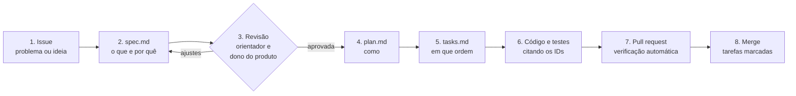

# Como contribuir com o Farol

O Farol é desenvolvido de forma orientada por especificação (Spec-Driven Development). Na prática, isso quer dizer uma regra simples: **nenhum comportamento novo entra no código sem uma spec aprovada antes**. O motivo da escolha está no [ADR 0001](docs/adr/0001-adotar-sdd-com-spec-kit.md), e as regras que valem para todo o projeto estão na [constituição](.specify/memory/constitution.md).

## O fluxo



### 1. Abra uma issue

Use o modelo **Nova funcionalidade ou mudança** em *Issues → New issue*. Descreva o problema, para quem ele existe e como se sabe que foi resolvido. Para defeitos, use o modelo **Defeito**: se o comportamento esperado já está numa spec, cite o requisito (por exemplo, `TUT-RF-04`).

### 2. Escreva ou altere a spec

- Funcionalidade nova: crie a pasta `specs/NNN-nome-curto/` com o próximo número livre e copie [`.specify/templates/spec-template.md`](.specify/templates/spec-template.md) para `spec.md`. Escolha um código de três letras que ainda não exista (veja [specs/README.md](specs/README.md)).
- Mudança em funcionalidade existente: altere o `spec.md` dela e registre a mudança na tabela "Histórico".
- Escreva o que o sistema faz, não como. Tecnologia fica para o plano.
- Marque toda dúvida com `[PRECISA ESCLARECER: pergunta]` em vez de adivinhar.

Crie um branch com o nome da pasta (`003-tutor-da-disciplina`) e abra um pull request só com a spec, para revisão.

### 3. Revisão da spec

O professor orientador e o dono do produto revisam o pull request. A spec é aprovada quando:

- todo requisito pode ser testado e tem pelo menos um cenário Dado / Quando / Então;
- todo critério de sucesso tem um número, um prazo ou uma proporção;
- os pontos a esclarecer foram resolvidos ou estão na tabela "Questões em aberto" com dono e prazo;
- nada contraria a constituição.

Ao aprovar, mude o status da spec para **Aprovada**.

### 4. Escreva o plano

Copie [`.specify/templates/plan-template.md`](.specify/templates/plan-template.md) para `plan.md`. Preencha a verificação da constituição e a tabela "Como o protótipo implementa", com uma linha por requisito funcional. Se o plano exigir uma decisão que afeta o projeto todo, escreva um [ADR](docs/adr/README.md).

Se, ao planejar, aparecer uma regra nova, ela volta para a spec primeiro.

### 5. Quebre em tarefas

Copie [`.specify/templates/tasks-template.md`](.specify/templates/tasks-template.md) para `tasks.md`. Cada tarefa tem um identificador (`TUT-T21`), a história a que pertence e os requisitos que atende entre parênteses. Os testes vêm antes da implementação. Tarefas grandes podem virar issues no GitHub.

### 6. Implemente

- Cite os requisitos no código. No protótipo, cada arquivo de tela começa com um comentário `/* Specs: TUT-RF-02, TUT-RF-04. ... */`. No produto, os testes de aceite levam o identificador no nome (`test_tut_rf_04_nao_encontrei_sem_chamar_o_modelo`).
- Se o código precisar se comportar diferente do que a spec diz, pare e atualize a spec. Código e spec divergentes não entram.

### 7. Abra o pull request

O modelo de pull request traz um checklist. O GitHub Actions roda `scripts/verificar_specs.py`, que confere:

- se cada spec tem `spec.md`, `plan.md` e `tasks.md`;
- se todo requisito funcional está no plano e em pelo menos uma tarefa;
- se todo identificador citado em documentos ou no código existe;
- se os links entre documentos funcionam;
- se a [matriz de rastreabilidade](docs/rastreabilidade.md) está atualizada.

Rode antes de abrir o PR:

```bash
python3 scripts/verificar_specs.py --gerar
```

### 8. Depois do merge

Marque as tarefas concluídas em `tasks.md` (`- [x]`) no mesmo PR e, quando todas as de uma etapa estiverem feitas, atualize o status da spec.

## Convenções

| Item | Convenção | Exemplo |
| --- | --- | --- |
| Branch de funcionalidade | Nome da pasta da spec | `005-questoes-e-quizzes` |
| Branch de documentação | `docs/assunto` | `docs/adota-sdd` |
| Mensagem de commit | Verbo no presente, em português, com os IDs no fim | `Adiciona pré-visualização da dúvida (DUV-T05, DUV-RF-02)` |
| Pull request | Título curto e, no corpo, os requisitos e tarefas atendidos | `Fecha DUV-T05` |
| Idioma | Português do Brasil em documentos, telas e nomes de domínio do código | `Duvida`, `RadarSemanal` |

## Usando o Spec Kit e assistentes de IA (opcional)

Os arquivos seguem a estrutura do [GitHub Spec Kit](https://github.com/github/spec-kit). Quem quiser pode instalar a ferramenta `specify` e usar os comandos `/speckit.specify`, `/speckit.plan` e `/speckit.tasks` num assistente de código compatível. Duas regras continuam valendo:

1. O texto gerado é um rascunho: uma pessoa revisa cada linha antes do pull request.
2. Os modelos em português de `.specify/templates/` são os oficiais do projeto.

## Protótipo navegável

O protótipo na raiz do repositório segue as mesmas regras. Antes de mudar uma tela, veja a spec e a tarefa correspondente. As pendências do protótipo estão listadas na [matriz de rastreabilidade](docs/rastreabilidade.md#pendências-do-protótipo).
