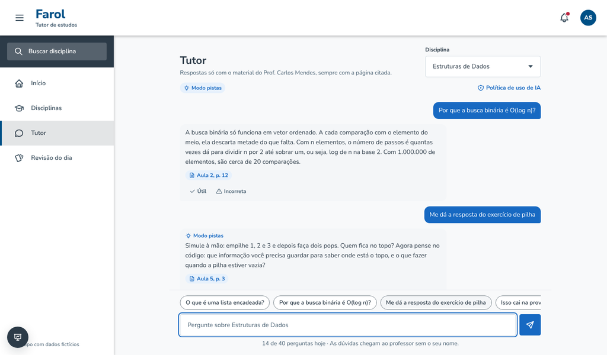
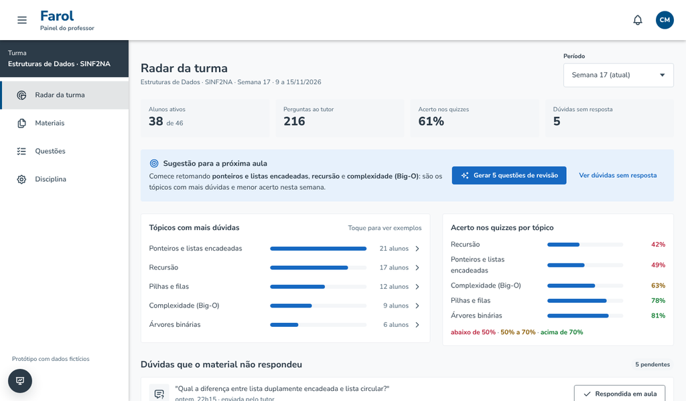
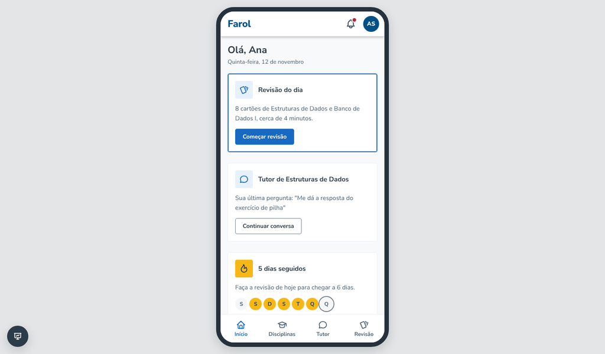

# Farol · protótipo navegável

Protótipo clicável do **Farol**, um tutor de estudos com IA pensado para a UNIMATER. O tutor responde só com o material que o professor publicou e cita a página de onde tirou a resposta. O material vira quizzes e uma revisão diária, e o professor recebe um radar anônimo das dúvidas da turma.

Todos os dados são fictícios e usam o curso de **Sistemas de Informação** como cenário: a aluna Ana Souza, do 2º período (turma SINF2NA), e o professor Carlos Mendes, de Estruturas de Dados.



## Documentação

O Farol é desenvolvido de forma orientada por especificação (Spec-Driven Development), na convenção do [GitHub Spec Kit](https://github.com/github/spec-kit). A especificação é a fonte da verdade: o código, inclusive o deste protótipo, segue o que está nela.

| Documento | O que tem |
| --- | --- |
| [Visão do produto](docs/visao-do-produto.md) | Problema, público, jornadas, métricas de sucesso, roteiro e riscos |
| [Constituição](.specify/memory/constitution.md) | Os princípios que valem para todas as funcionalidades |
| [Especificações](specs/README.md) | Uma pasta por funcionalidade, com `spec.md` (o quê), `plan.md` (como) e `tasks.md` (em que ordem) |
| [Arquitetura](docs/arquitetura.md) | Stack, trade-offs, fluxos do tutor e do radar, segurança e LGPD |
| [Decisões (ADR)](docs/adr/README.md) | Registro das decisões técnicas e das alternativas descartadas |
| [Matriz de rastreabilidade](docs/rastreabilidade.md) | Cada requisito, o que o protótipo já cobre, onde está no código e as tarefas |
| [Glossário](docs/glossario.md) | O sentido exato de cada termo usado nas specs |
| [Como contribuir](CONTRIBUTING.md) | O fluxo issue, spec, plano, tarefas, código e pull request |

## Como abrir

O protótipo não precisa de instalação, servidor nem internet: as fontes e os ícones estão dentro do repositório.

1. Baixe o repositório (botão **Code → Download ZIP**) ou clone com `git clone https://github.com/Chicosk1/farol`.
2. Abra o arquivo `index.html` no Chrome, Edge ou Firefox.

Para ter um link público, ative o GitHub Pages em **Settings → Pages → Build and deployment**, escolhendo a branch `main` e a pasta `/ (root)`. O endereço aparece na própria página de configuração.

## Roteiro de apresentação (cerca de 5 minutos)

1. **Entrada.** Clique em *Entrar como aluna*.
2. **Início.** Mostre a revisão do dia, o atalho para o tutor e a sequência de dias.
3. **Tutor.** Use as sugestões de pergunta:
   - *O que é uma lista encadeada?* mostra a resposta com a citação "Aula 4, p. 5". Clique na citação para abrir a página do PDF com o trecho destacado.
   - *Me dá a resposta do exercício de pilha* mostra o modo pistas: o tutor guia em vez de entregar a resposta.
   - *Isso cai na prova?* mostra que o tutor não inventa. Ele avisa que o assunto não está no material e oferece **Enviar dúvida ao professor**. Clique nesse botão.
4. **Revisão do dia.** Responda um cartão, abra a justificativa e avalie com Difícil, Bom ou Fácil.
5. **Troque para Professor** na barra de demonstração, no canto inferior esquerdo.
6. **Radar.** A dúvida que a aluna mandou aparece em *Dúvidas que o material não respondeu*, marcada como **Nova** e sem nome. Mostre os tópicos com mais dúvidas, clicando em um deles para ver exemplos, e a sugestão para a próxima aula.
7. **Gerar 5 questões de revisão.** Abre a tela de Questões com os rascunhos. Aprove um, edite outro e descarte um terceiro.
8. **Disciplina.** Ligue o **Modo prova**, volte para a aluna e abra o tutor: ele aparece pausado.
9. Ligue o **tema escuro** e a **moldura de celular** na barra de demonstração.
10. **Processo.** Para fechar, mostre no GitHub o requisito `TUT-RF-04` em [specs/003-tutor-da-disciplina/spec.md](specs/003-tutor-da-disciplina/spec.md), que descreve o "não encontrei" da etapa 3, e depois a linha dele na [matriz de rastreabilidade](docs/rastreabilidade.md), ligada ao arquivo da tela e às tarefas.

O botão de recarregar, na barra de demonstração, volta tudo ao estado inicial.

## Telas

| Perfil | Tela | O que mostra |
| --- | --- | --- |
| Aluna | Início | Revisão do dia, atalho para o tutor, sequência de dias, novidades e disciplinas |
| Aluna | Disciplinas | Busca, abas (Todas, Favoritas, Com tutor), grade ou lista e favoritos |
| Aluna | Disciplina | Materiais em PDF, quizzes aprovados pelo professor e acesso ao tutor |
| Aluna | Tutor | Chat com citação clicável, modo pistas, modo prova, limite diário, avaliação da resposta e envio anônimo de dúvida |
| Aluna | Revisão do dia e Quiz | Questões com retorno imediato, link para o trecho do material e avaliação de dificuldade |
| Professor | Radar da turma | Indicadores, tópicos com mais dúvidas, acerto por tópico, sugestão para a próxima aula e dúvidas sem resposta |
| Professor | Materiais | Envio de PDF, simulado, com as etapas de processamento até "Pronto para o tutor" |
| Professor | Questões | Geração de rascunhos, com aprovação, edição e descarte |
| Professor | Disciplina | Modo pistas, modo prova, limite diário, resumo semanal e política de uso de IA |

<p>
  
  
</p>

## Como as duas visões se conversam

O protótipo guarda o estado no navegador, então uma ação de um perfil aparece no outro:

- A dúvida enviada pela aluna aparece no radar do professor e no sino de notificações.
- Cada pergunta feita ao tutor soma em *Perguntas ao tutor*, no radar.
- A questão aprovada pelo professor entra no quiz da disciplina, na visão da aluna.
- O modo prova pausa o tutor para a aluna, e o modo pistas muda o tipo de resposta.
- A política de uso de IA editada pelo professor aparece no tutor.
- O PDF enviado pelo professor aparece na lista de materiais da aluna quando o processamento termina.

## Estrutura

```
.specify/
  memory/constitution.md  princípios do projeto
  templates/              modelos de spec, plano e tarefas em português
specs/                    uma pasta por funcionalidade (spec.md, plan.md, tasks.md)
docs/                     visão, arquitetura, ADRs, glossário e matriz de rastreabilidade
scripts/
  verificar_specs.py      verifica as specs e gera a matriz de rastreabilidade
.github/                  modelos de issue e pull request e a verificação automática
index.html                página única; carrega os estilos e os scripts na ordem
css/
  fonts.css               Nunito Sans embutida, para funcionar sem internet
  tokens.css              cores, espaços e tamanhos do design system Farol (temas claro e escuro)
  components.css          componentes do design system (classes fr-)
  app.css                 layout das telas e peças do protótipo (modal, toast, switch)
js/
  data.js                 dados fictícios: disciplinas, materiais, trechos citados, respostas do tutor, questões e radar
  store.js                estado do protótipo, salvo no localStorage
  tutor.js                tutor simulado: escolhe a resposta por palavras-chave
  ui.js                   utilitários: ícones, modais, toasts, cartões
  shell.js                cabeçalho, menu lateral, barra inferior no celular e barra de demonstração
  main.js                 rotas (#/aluno/..., #/professor/...) e eventos
  icons.js                ícones Tabler usados no protótipo
  screens/                uma tela por arquivo; cada arquivo cita no topo os requisitos que implementa
assets/fonts/             arquivo original da fonte e a licença
docs/telas/               capturas de tela deste README
```

## Como mudar o cenário

Quase tudo o que aparece na tela vem de `js/data.js`:

- **Outra disciplina ou outro curso:** edite `disciplinas`, `materiais` e `curso`.
- **Nova resposta do tutor:** acrescente um item em `tutor.ed`, com as palavras-chave (`keys`, sem acento), a resposta direta, a versão do modo pistas e a citação.
- **Nova página citada:** acrescente um item em `citations`, com o trecho que aparece destacado.
- **Números do radar:** edite `radar.s17` e `radar.s16`.

Depois de mudar os dados, use o botão de recarregar da barra de demonstração para limpar o estado salvo.

## Decisões técnicas

- **HTML, CSS e JavaScript puros, sem etapa de build** ([ADR 0002](docs/adr/0002-prototipo-sem-framework.md)). O protótipo abre com dois cliques, funciona sem internet na hora da apresentação, e qualquer pessoa do grupo consegue editar. O produto final segue a [arquitetura](docs/arquitetura.md) (React com TypeScript, Django e PostgreSQL); as telas e os dados deste protótipo servem de referência visual para essa versão.
- **Design system Farol.** Cores, tipografia, espaços e componentes vêm do design system criado a partir da plataforma acadêmica da UNIMATER, com temas claro e escuro.
- **Acessibilidade.** Navegação completa por teclado com foco visível, contraste mínimo de 4,5:1 nos textos dos dois temas, rótulos para leitor de tela e respeito à preferência de reduzir animações.

## Limitações

A [matriz de rastreabilidade](docs/rastreabilidade.md) mostra, requisito por requisito, o que é real, o que é simulado e o que ainda falta. Em resumo:

- O tutor não usa IA: escolhe respostas prontas por palavras-chave. Perguntas fora da base caem em "não encontrei no material", o que também é o comportamento esperado do produto.
- Os dados ficam só no navegador de quem está usando (localStorage).
- O envio de PDF é simulado: o arquivo não sai do computador.
- O login é só a escolha de perfil; no produto, o acesso é pela conta institucional.

## Créditos

- Ícones: [Tabler Icons](https://tabler.io/icons) v3.51.0, licença MIT.
- Fonte: [Nunito Sans](https://github.com/googlefonts/NunitoSans), licença SIL Open Font License 1.1 (veja `assets/fonts/OFL.txt`).
- Nomes, turmas, notas e conteúdos são fictícios.
