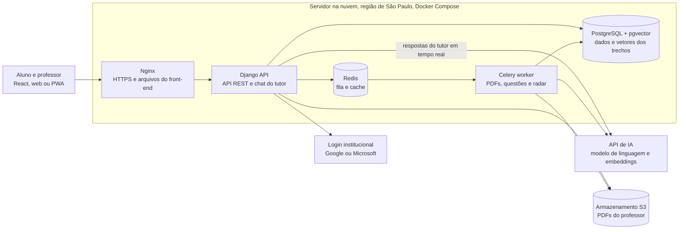
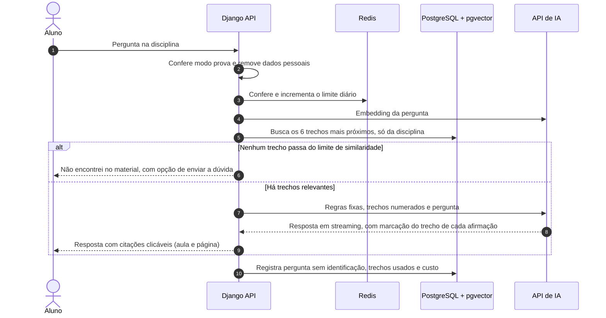

# Arquitetura

Este documento descreve a arquitetura do produto Farol, os fluxos principais e o porquê de cada escolha. As decisões com mais alternativas em jogo têm um registro próprio em [docs/adr](adr/README.md). O que cada funcionalidade faz está nas [especificações](../specs/README.md).

A stack foi escolhida pelo critério "qualquer desenvolvedor pleno do mercado consegue manter": são cinco peças em um servidor, mais três serviços externos conhecidos.

## Visão geral

O navegador fala só com o Nginx. O Django atende as telas e o chat do tutor. Tudo o que demora (ler PDFs, gerar questões, montar o radar) entra na fila do Redis e é executado pelo Celery. O upload do professor é gravado no S3, de onde o Celery lê o arquivo.

## Escolhas e trade-offs

| Camada | Escolha | Alternativas avaliadas | Por que esta | Do que abrimos mão |
| --- | --- | --- | --- | --- |
| Interface | React + TypeScript + Vite, com Tailwind CSS | Next.js, Angular, Vue | Maior oferta de desenvolvedores no Brasil. O app fica atrás de login e não precisa de SEO, então um SPA com Vite é mais simples que Next.js | Primeiro carregamento um pouco mais lento que com renderização no servidor, irrelevante para uso logado |
| Celular | PWA: o mesmo site, instalável na tela inicial | App nativo, React Native, Flutter | Um único código, sem loja de apps e com atualização instantânea | Notificações no iPhone só com o app na tela inicial; sem presença nas lojas |
| Back-end | Python + Django + Django REST Framework, versão LTS ([ADR 0003](adr/0003-django-no-back-end.md)) | FastAPI, Node.js com NestJS | Login, ORM, migrações e painel administrativo prontos. Python é a linguagem padrão de IA e de leitura de PDF | Duas linguagens no projeto; Django é mais opinativo e pesado que FastAPI |
| Banco de dados | PostgreSQL com pgvector ([ADR 0004](adr/0004-postgresql-com-pgvector.md)) | MySQL; banco vetorial dedicado (Pinecone, Qdrant, Weaviate) | Um só banco guarda dados e vetores: um backup, uma conexão, transações consistentes. Volume estimado de 100 mil trechos | Com dezenas de milhões de vetores, um banco dedicado seria mais rápido |
| Tarefas em segundo plano | Celery com Redis | RQ, tarefas nativas do Django (recente), cron | Padrão do ecossistema Django. O Redis também serve de cache e de contador do limite diário | Mais um serviço para operar |
| IA | Modelo de linguagem e embeddings via API de um provedor de mercado, atrás de um módulo próprio ([ADR 0005](adr/0005-ia-via-api-com-modulo-proprio.md)) | Modelo aberto em GPU própria (Llama, Qwen) | Qualidade alta sem manter GPU, pagamento por uso, troca de provedor em um único módulo | Custo variável, dependência de terceiro e dados saindo da instituição |
| Orquestração da IA | Código próprio e enxuto com o SDK oficial do provedor ([ADR 0005](adr/0005-ia-via-api-com-modulo-proprio.md)) | LangChain, LlamaIndex | O fluxo é curto: buscar trechos, montar o prompt, chamar o modelo. Menos camadas, depuração mais fácil | Escrever à mão utilitários que essas bibliotecas dão prontos |
| Leitura de PDF | pypdf | PyMuPDF (licença AGPL), serviços de OCR | Licença permissiva e extração página a página, que permite citar a página | Não lê PDF escaneado; OCR fica para a expansão |
| Login | OpenID Connect com Google Workspace ou Microsoft 365, via django-allauth | Usuário e senha próprios | O aluno entra com a conta que já tem, e a TI não administra senhas | Depende de conta institucional ativa; link mágico por e-mail como plano B |
| Arquivos | Armazenamento compatível com S3, via django-storages | Disco do próprio servidor | Backup e troca de máquina triviais | Mais um serviço contratado, de custo baixo |
| Infraestrutura | Docker Compose em uma máquina virtual em São Paulo, com Nginx e HTTPS ([ADR 0006](adr/0006-docker-compose-em-um-servidor.md)) | Kubernetes; Render, Railway, Heroku | O mesmo arquivo sobe o sistema no notebook e em produção | Ponto único de falha, aceitável no piloto com backup diário |
| Qualidade e operação | GitHub + GitHub Actions, pytest e Vitest, Sentry para erros | GitLab CI, Jenkins | Padrão de mercado e gratuito para começar | Dependência de serviços de terceiros |

Regra para todas as camadas: versões com suporte de longo prazo (LTS) sempre que existirem.

## Fluxos principais

O tutor usa RAG (geração aumentada por recuperação): antes de responder, busca no material do professor os trechos mais parecidos com a pergunta e envia ao modelo só esses trechos, com a ordem de não ir além deles. É isso que garante a citação e reduz respostas inventadas.

### 1. O professor publica um PDF (spec [002](../specs/002-materiais-da-disciplina/spec.md))

1. O arquivo vai para o S3 e uma tarefa entra na fila.
2. O Celery extrai o texto página por página com o pypdf.
3. O texto é dividido em trechos de cerca de 500 tokens, com pequena sobreposição. Cada trecho guarda a aula, o arquivo e a página de origem.
4. Cada trecho vira um vetor (embedding) e é salvo no PostgreSQL com pgvector.
5. O professor recebe o aviso de que o material está pronto.

### 2. O aluno pergunta (specs [003](../specs/003-tutor-da-disciplina/spec.md) e [004](../specs/004-duvidas-ao-professor/spec.md))

Quando nenhum trecho é relevante, o modelo nem é chamado, o que também economiza custo.

### 3. O professor gera questões (spec [005](../specs/005-questoes-e-quizzes/spec.md))

1. Ele escolhe a aula, e o Celery envia os trechos dela ao modelo pedindo N questões em formato estruturado (JSON), com gabarito, justificativa e trecho de origem.
2. O sistema valida o formato e descarta questões sem trecho de origem.
3. As questões entram como rascunho na tela de revisão do professor.

### 4. Toda madrugada, o radar (spec [007](../specs/007-radar-da-turma/spec.md))

1. O Celery reúne as perguntas da semana de cada disciplina e as agrupa pela proximidade dos vetores, com um algoritmo simples do scikit-learn.
2. Grupos com menos de 5 alunos distintos são descartados.
3. O modelo dá um nome curto a cada grupo e escolhe perguntas de exemplo.
4. Os grupos são cruzados com as taxas de acerto dos quizzes para sugerir 3 tópicos para retomar.

## Segurança, LGPD e integridade acadêmica

Só saem da instituição para o provedor de IA o texto da pergunta, sem identificação, e trechos do material didático. As regras completas estão nos princípios IV e III da [constituição](../.specify/memory/constitution.md). Na arquitetura, elas viram:

| Tema | Como a arquitetura atende |
| --- | --- |
| Minimização | O prompt é montado só com regras fixas, trechos e a pergunta filtrada. Nome, RA, e-mail e turma nunca entram |
| Contrato com o provedor | Plano empresarial com retenção zero e sem uso dos dados para treino. Transferência internacional validada com o DPO |
| Anonimato no radar | O agrupamento trabalha com perguntas sem autoria; grupos com menos de 5 alunos distintos são descartados antes de qualquer exibição |
| Retenção | Proposta de 12 meses para as perguntas, depois apagadas ou mantidas só de forma agregada |
| Localização | Banco e arquivos na região de São Paulo |
| Acesso | HTTPS em tudo, entrada só por conta institucional e permissões por disciplina |
| Segredos | Chaves de API em variáveis de ambiente |
| Custo | Limite diário por aluno no Redis e alerta de orçamento no provedor |
| Backup | Diário, com teste de restauração mensal |
| Prompt injection | Regras fixas no servidor, só material publicado por professores, resposta exibida como texto, sem executar nada |
| Revisão de código | Checklist OWASP Top 10 |

## Controle de qualidade da IA

- Um conjunto fixo de 100 perguntas reais por disciplina piloto, com a resposta e o trecho esperados, roda no GitHub Actions a cada mudança de prompt ou de modelo. Se a taxa de citação correta cair abaixo de 90%, o pull request é bloqueado.
- Respostas marcadas como incorretas pelos alunos entram numa fila de revisão semanal da equipe.

## Custos estimados de operação

A IA é o menor custo do projeto: cerca de R$ 0,14 por aluno por mês no cenário econômico e R$ 1,43 no conservador (premissas: 40 perguntas por aluno ativo por mês, 4.000 tokens de entrada e 500 de saída por pergunta, câmbio de R$ 5,51). O servidor fica entre R$ 400 e R$ 800 por mês. O maior custo é a equipe.

## O protótipo e a arquitetura

O protótipo navegável deste repositório não tem servidor: ele roda inteiro no navegador ([ADR 0002](adr/0002-prototipo-sem-framework.md)). Cada peça da arquitetura tem um substituto simulado:

| Peça do produto | Substituto no protótipo |
| --- | --- |
| React + design system | HTML, CSS e JavaScript puros, com os tokens e componentes do design system Farol (`css/tokens.css`, `css/components.css`) |
| Django API e PostgreSQL | Estado em memória salvo no `localStorage` (`js/store.js`) |
| Busca nos trechos e modelo de linguagem | Respostas prontas escolhidas por palavras-chave (`js/tutor.js`, base em `js/data.js`) |
| Celery processando PDFs | Etapas de processamento simuladas com temporizador (`js/screens/prof-materiais.js`) |
| Geração de questões | Banco fixo de questões por aula (`bancoGeracao` em `js/data.js`) |
| Radar calculado de madrugada | Números fixos por semana (`radar` em `js/data.js`) |
| Login institucional | Escolha de perfil (`js/screens/entrar.js`) |

A [matriz de rastreabilidade](rastreabilidade.md) mostra, requisito por requisito, o que o protótipo já cobre.
