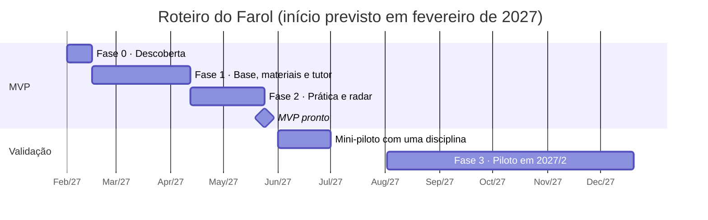

# Visão do produto

Este documento explica por que o Farol existe, para quem ele é e como saberemos se deu certo. As regras detalhadas de cada funcionalidade ficam nas [especificações](../specs/README.md), e as regras que valem para todas elas ficam na [constituição](../.specify/memory/constitution.md).

## Em uma frase

O Farol é um tutor de estudos com IA que responde só com base no material do professor, transforma esse material em prática e devolve ao professor um radar anônimo das dúvidas da turma.

**Visão:** nenhum aluno da UNIMATER estuda sozinho, e nenhum professor descobre só na prova o que a turma não entendeu.

## Contexto

O Centro Universitário Mater Dei (UNIMATER), em Pato Branco (PR), tornou-se centro universitário pela Portaria MEC nº 819, de 14/10/2021, com conceito 5 ([Câmara Municipal de Pato Branco](https://www.patobranco.pr.leg.br/institucional/noticias/faculdade-mater-dei-recebe-mocao-de-aplauso)). Como centro universitário, tem autonomia para abrir cursos e experimentar, e o curso de Sistemas de Informação permite envolver alunos no desenvolvimento como projeto de extensão.

O problema de fundo é a permanência. Em 2024, a evasão nos cursos presenciais da rede privada chegou a 26,6%, contra 21,4% na rede pública ([Semesp, Mapa do Ensino Superior, via Jornal de Brasília](https://jornaldebrasilia.com.br/noticias/brasil/4-em-cada-10-alunos-de-graduacao-ead-desistem-de-estudar-numero-e-o-maior-desde-2014/)). Parte dessa evasão nasce em sala de aula.

## Problemas que o Farol ataca

A validar na fase de descoberta:

| Problema | Quem sente |
| --- | --- |
| Reprovação nas disciplinas-base dos primeiros períodos, que desanima o aluno logo no início | Aluno |
| Estudo fora do horário de aula, à noite ou no fim de semana, sem professor ou monitor disponível | Aluno que trabalha |
| Vergonha de perguntar em sala, principalmente dúvidas que parecem básicas | Aluno |
| O professor só descobre o que a turma não entendeu quando corrige a prova | Professor |
| Alunos já usam chatbots genéricos que respondem fora do conteúdo e às vezes inventam | Aluno e professor |

## Para quem

| Perfil | O que ganha | O que faz no Farol |
| --- | --- | --- |
| Aluno | Tira dúvidas a qualquer hora, sabe exatamente onde estudar e revisa em 5 minutos por dia | Pergunta ao tutor, faz quizzes e a revisão diária |
| Professor | Sabe o que a turma não entendeu antes da prova e ganha questões prontas para revisar | Sobe o material, aprova questões, lê o radar e controla os modos do tutor |
| Coordenação e NDE | Visão agregada de quais disciplinas e tópicos travam os alunos | Consulta um painel agregado (expansão) |
| TI | Um sistema com ferramentas conhecidas, simples de manter | Administra usuários, custo e disponibilidade |

## Por que não usar só uma IA pronta

| Critério | Chatbot genérico | Ferramenta individual de PDF | Farol |
| --- | --- | --- | --- |
| Responde com base no material da disciplina | Não | Sim, se o aluno subir o material | Sim, publicado pelo professor |
| Mostra a fonte da resposta | Raramente | Sim | Sim, com aula e página |
| Devolve informação ao professor | Não | Não | Sim, pelo radar da turma |
| Segue regras da disciplina (modo prova, pistas) | Não | Não | Sim |
| Dados sob contrato e política da instituição | Não | Não | Sim |

O diferencial não é a IA, que já é commodity. É o ciclo fechado entre o estudo do aluno e o planejamento do professor.

## Funcionalidades

O MVP tem uma base comum e três funcionalidades centrais. Cada uma está detalhada em uma especificação:

| Funcionalidade | Especificações |
| --- | --- |
| Base comum: login institucional, perfis, turmas | [001 Acesso e turmas](../specs/001-acesso-e-turmas/spec.md) |
| Material do professor, que alimenta tudo | [002 Materiais da disciplina](../specs/002-materiais-da-disciplina/spec.md) |
| F1. Tutor da disciplina | [003 Tutor da disciplina](../specs/003-tutor-da-disciplina/spec.md), [004 Dúvidas ao professor](../specs/004-duvidas-ao-professor/spec.md) |
| F2. Prática ativa | [005 Questões e quizzes](../specs/005-questoes-e-quizzes/spec.md), [006 Revisão do dia](../specs/006-revisao-do-dia/spec.md) |
| F3. Radar da turma | [007 Radar da turma](../specs/007-radar-da-turma/spec.md) |

## Jornadas de uso

As personas são fictícias e são as mesmas do protótipo.

**Ana, 2º período de Sistemas de Informação, trabalha durante o dia**

1. **22h, em casa.** Abre o Farol no celular, escolhe Estruturas de Dados e pergunta o que é uma lista encadeada. O tutor responde e cita "Aula 4, p. 5". Ela toca na citação e vê o trecho destacado no PDF.
2. **22h10.** Pede a resposta do exercício de pilha. O modo pistas está ligado, então o tutor faz perguntas que a levam até a solução.
3. **22h20.** Pergunta se "isso cai na prova". O tutor diz que o material não responde isso e oferece enviar a dúvida ao professor. Ela envia, sem o nome dela.
4. **Na manhã seguinte, no ônibus.** Faz a revisão do dia: 8 cartões em 4 minutos.

**Prof. Carlos Mendes, Estruturas de Dados**

1. **Domingo, 2 minutos.** Sobe o PDF da Aula 7. O sistema processa em segundo plano e avisa quando o material está pronto.
2. **Domingo, 10 minutos.** Gera 10 questões da Aula 7. Aprova 8, edita 1 e descarta 1.
3. **Segunda, 7h.** Recebe o resumo do radar: "Ponteiros e listas encadeadas" concentrou dúvidas de 21 alunos.
4. **Segunda, 19h.** Abre a aula com 10 minutos de revisão sobre listas e responde em sala a dúvida anônima sobre a prova.
5. **Antes da prova.** Ativa o modo prova para quinta-feira, das 19h às 22h.

## Métricas de sucesso do piloto

A métrica que decide a expansão é o impacto acadêmico. As outras explicam por que o resultado veio ou não.

| Métrica | Meta no piloto | Como medir |
| --- | --- | --- |
| Impacto acadêmico | Aprovação e nota média maiores que nas turmas de controle da mesma disciplina | Notas finais do sistema acadêmico, no fim do semestre |
| Adesão dos alunos | 60% dos alunos das turmas piloto usam o Farol pelo menos 1 vez por semana | Registros de uso |
| Adesão dos professores | 80% dos professores piloto abrem o radar toda semana | Registros de uso |
| Qualidade das respostas | 90% com citação correta no conjunto de teste e no máximo 5% marcadas como incorretas | Teste automático e avaliação dos alunos |
| Questões geradas | 70% aprovadas sem edição pesada | Tela de revisão do professor |
| Satisfação | NPS de pelo menos 40 entre alunos e professores | Questionário no fim do semestre |
| Custo de IA | Até R$ 2 por aluno por mês | Registro de tokens por chamada |

## Roteiro

O MVP leva 16 semanas, em fases fechadas por um critério de passagem: se o critério não é atingido, a fase seguinte não começa.

| Fase | Entrega | Marco de passagem |
| --- | --- | --- |
| 0. Descoberta (semanas 1 e 2) | Entrevistas com 5 professores e 20 alunos, escolha de 3 ou 4 disciplinas piloto, provedor de login e de IA definidos, tratamento de dados validado com o DPO, 100 perguntas de teste por disciplina | Marco 1: piloto e LGPD aprovados |
| 1. Base, materiais e tutor (semanas 3 a 10) | Specs 001, 002, 003 e 004 | Marco 2: 90% de citações corretas no conjunto de teste |
| 2. Prática e radar (semanas 11 a 16) | Specs 005, 006 e 007 | Marco 3: professores piloto aprovam o fluxo |
| Mini-piloto (junho de 2027) | Uma disciplina real com o MVP, para ajustes antes do piloto | |
| 3. Piloto (2027/2) | Uso real em 3 ou 4 disciplinas, com turmas de controle | Marco 4: ganho sobre as turmas de controle |
| 4. Expansão (2028) | Mais disciplinas e integrações | |

## Riscos principais

| Risco | Impacto | Mitigação |
| --- | --- | --- |
| O tutor responde errado ou inventa | Alto | Só trechos do material, citação obrigatória, "não encontrei" quando não há base, teste automático e botão para marcar resposta incorreta |
| Professores não aderem | Alto | Esforço mínimo (subir um PDF), professor como dono do produto, piloto só com voluntários |
| Problemas com a LGPD | Alto | Minimização de dados, contrato com retenção zero, DPO desde a fase 0 e anonimato no radar |
| Alunos usam o tutor para colar | Médio | Modo pistas, modo prova e política de uso de IA por disciplina |
| Custo de IA acima do previsto | Médio | Limite diário, teto de orçamento e modelo econômico como padrão |
| Material ilegível (PDF escaneado) | Médio | Checagem no envio com aviso ao professor; OCR na expansão |
| Dependência de um único provedor de IA | Médio | Módulo de abstração e teste periódico com um segundo provedor |
| Equipe pequena, saída de alguém-chave | Médio | Stack popular, documentação orientada por specs e ambiente reproduzível |

## Fora do escopo

O Farol não é um AVA, não corrige provas e não é um chatbot de assuntos gerais. Também não toca em matrícula, notas ou financeiro.

Depois do piloto, a evolução segue esta ordem de valor:

1. Integração com o AVA via LTI 1.3, para abrir o Farol dentro da disciplina sem novo login.
2. OCR para PDFs escaneados e leitura direta de slides em PPTX.
3. Transcrição de aulas gravadas, para citar o minuto exato do vídeo.
4. Painel da coordenação e do NDE, com os tópicos críticos por curso.
5. Simulados do ENADE por curso, com questões de provas anteriores divulgadas pelo Inep.
6. Alerta de desengajamento, com consentimento do aluno, só depois de validar a privacidade.

## Questões em aberto

| Questão | Impacto |
| --- | --- |
| Quantos alunos e disciplinas a UNIMATER tem hoje e quais disciplinas têm mais reprovação | Tamanho do piloto e custo |
| O login institucional é Google Workspace ou Microsoft 365 | Spec 001 |
| Qual AVA a UNIMATER usa | Integração na expansão |
| Base legal e transferência internacional de dados para o provedor de IA | Validação com o DPO na fase 0 |
| Equipe contratada ou fábrica de software com alunos de Sistemas de Informação | Custo e prazo |

## Origem deste documento

Este documento consolida o documento de idealização do projeto (novembro de 2026). A partir da adoção do desenvolvimento orientado por especificação, o repositório passa a ser a fonte da verdade: mudanças de visão são feitas aqui, por pull request.
